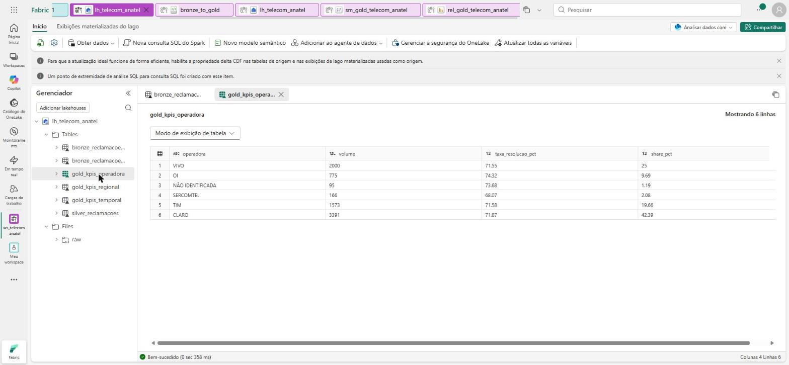
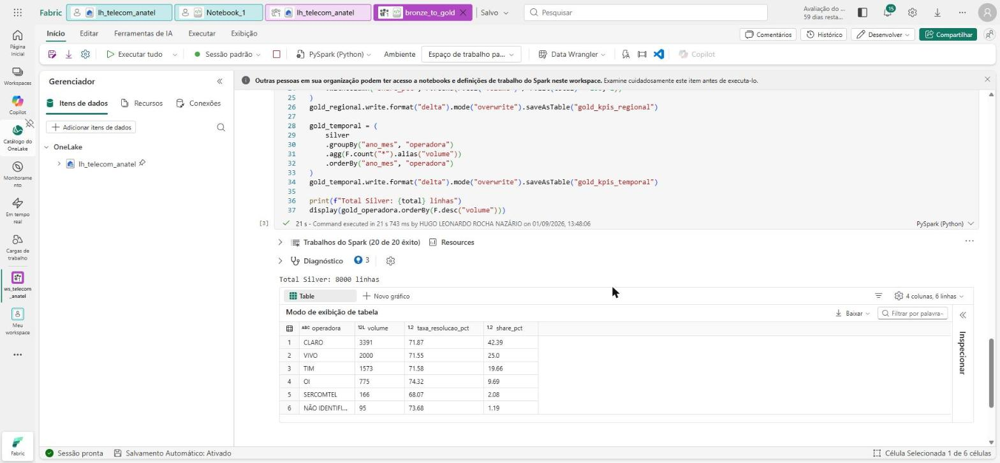
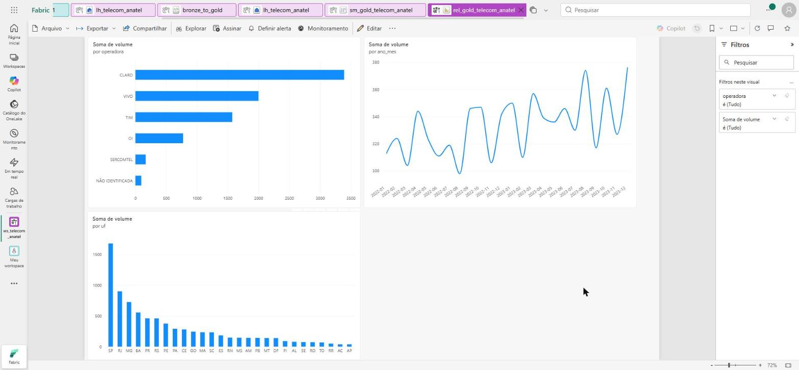

# Fabric Lakehouse Demo — mesmo dataset, arquitetura de nuvem

O `.pbix` na raiz deste repositório importa dados de CSV local. Esta pasta demonstra o
mesmo dataset (reclamações ANATEL) processado como **Lakehouse no Microsoft Fabric**,
com arquitetura medallion (Bronze → Silver → Gold) em PySpark e um relatório Power BI em
modo **Direct Lake** — o cenário de quem já trabalha com Data Lake/Fabric em produção, não
só com Power BI Desktop isolado.

**Executado de ponta a ponta em 01/09/2026**, em capacidade de avaliação do Fabric
(Brazil South), workspace `ws_telecom_anatel`.



## O que este demo prova

A Gold gerada no Fabric bate **número por número** com o `outputs/kpis_por_operadora.csv`
do pipeline pandas deste mesmo repositório:

| operadora | volume | taxa_resolucao_pct | share_pct |
|---|---:|---:|---:|
| CLARO | 3.391 | 71,87 | 42,39 |
| VIVO | 2.000 | 71,55 | 25,00 |
| TIM | 1.573 | 71,58 | 19,66 |
| OI | 775 | 74,32 | 9,69 |
| SERCOMTEL | 166 | 68,07 | 2,08 |
| NÃO IDENTIFICADA | 95 | 73,68 | 1,19 |
| **total** | **8.000** | | |

Duas implementações independentes da mesma regra de negócio — pandas e PySpark — sobre a
mesma fonte, chegando ao mesmo lugar. É isso que torna o número confiável.

## Por que isto existe

O `telecom-powerbi-public` já prova modelagem dimensional, DAX e Power Query. O que ele
não prova é a parte que aparece em vagas mais avançadas de BI: conectar a fontes mais
complexas, trabalhar com Data Lake/Dataflows e operar dentro do ecossistema Fabric/Azure.
Em vez de inventar um projeto novo do zero, esta pasta reaproveita o dataset e a regra de
negócio já validados no projeto principal — só muda onde e como o dado é processado.

## Arquitetura

Ver [`docs/architecture.md`](docs/architecture.md) para o diagrama completo. Resumo:

```
Files/raw/*.csv  →  Bronze (ingestão 1:1)  →  Silver (dedupe + limpeza + normalização)  →  Gold (KPIs agregados)  →  Power BI (Direct Lake)
```

O notebook completo está em [`notebooks/bronze_to_gold.ipynb`](notebooks/bronze_to_gold.ipynb).





## Checklist de execução (portal Fabric — manual, precisa de login)

1. **Licença**: criar workspace exige **Power BI Pro** (a avaliação de 60 dias serve). Só
   a capacidade de avaliação do Fabric não basta.
2. **Workspace**: criar um workspace de verdade com capacidade de avaliação do Fabric.
   **Não use o "Meu workspace"** — ver armadilha 1 abaixo.
3. **Lakehouse**: `Novo item → Lakehouse`, nome `lh_telecom_anatel`.
4. **Upload**: em `Files`, criar pasta `raw/` e subir `data/raw/reclamacoes_scm.csv` e
   `data/raw/reclamacoes_smp.csv` (deste repositório).
5. **Notebook**: `Importar → Notebook → A partir deste computador`, apontando para
   `notebooks/bronze_to_gold.ipynb`. Importar é melhor do que colar — ver armadilha 2.
   Anexar o Lakehouse do passo 3 como *default lakehouse* (ícone de pin) e `Executar tudo`.
6. **Conferir**: no Lakehouse, `Tables` deve mostrar `bronze_reclamacoes_scm`,
   `bronze_reclamacoes_smp`, `silver_reclamacoes`, `gold_kpis_operadora`,
   `gold_kpis_regional`, `gold_kpis_temporal`. Se não aparecerem, `Atualizar` na pasta.
7. **Modelo semântico Direct Lake**: abrir o **ponto de extremidade de análise SQL** do
   Lakehouse (item separado no workspace) → `Novo modelo semântico` → marcar as três
   `gold_kpis_*` → confirmar. Ver armadilha 3.
8. **Relatório**: no modelo semântico, `New report`, montar os visuais e salvar.
9. **Paridade**: comparar `gold_kpis_operadora` com `outputs/kpis_por_operadora.csv` do
   projeto principal — a tabela acima é essa conferência.

## As armadilhas (encontradas rodando de verdade)

1. **"Meu workspace" não hospeda modelo semântico Direct Lake.** O diálogo `Novo modelo
   semântico` responde *"Crie primeiro um espaço de trabalho"* e não deixa avançar. Todo
   o pipeline roda no workspace pessoal — Lakehouse, notebook, tabelas Delta — e só o
   último passo trava. Se já tiver rodado lá, dá para migrar sem subir CSV de novo:
   criar um **atalho do OneLake** (`Files → Novo atalho → Microsoft OneLake`) apontando
   para o `Files/raw` do Lakehouse antigo. O caminho `Files/raw/...` do notebook continua
   valendo, sem editar uma linha. Recuse a "transformação automática de CSV em Delta"
   que o assistente oferece: ela mata a camada Bronze (e ainda assume delimitador
   vírgula, sendo que o arquivo é `;`).
2. **Célula de texto colada vira célula de código.** Colando o notebook célula a célula,
   as células Markdown chegam como PySpark e o `Executar tudo` morre em
   `SyntaxError: invalid syntax` na primeira linha de prosa. Ou importa o `.ipynb`, ou
   converte cada célula de texto com o botão `M↓` da barra da célula.
3. **A lista de tabelas do Lakehouse vem vazia no diálogo do modelo semântico.** É bug de
   tela: o mesmo diálogo aberto pelo **ponto de extremidade de análise SQL** lista as seis
   tabelas normalmente. Não adianta recarregar o Lakehouse.
4. **O gráfico de linha nasce ordenado por valor, não por tempo.** O Power BI ordena por
   `Soma de volume` decrescente por padrão — a "série temporal" sai fora de ordem
   cronológica. `... → Classificar por → ano_mes → Classificar em ordem crescente`.

## Stack

`Microsoft Fabric` · `Lakehouse` · `PySpark` · `Delta Lake` · `OneLake shortcuts` · `Power BI (Direct Lake)`
