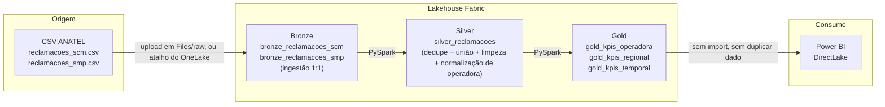

# Arquitetura — Fabric Lakehouse Demo

## Por que medallion e não uma tabela só

- **Bronze** existe para reprocessar a Silver sem depender do arquivo CSV original — e
  para auditar o dado exatamente como a fonte publicou, antes de qualquer regra de
  negócio ser aplicada.
- **Silver** aplica uma única vez o dedupe, a normalização de marca (mapear "Telefonica
  Brasil S.A." → `VIVO`) e a tipagem de data — a mesma regra usada em `src/kpis.py::_norm`
  e em `data_prep/prepare_data.py`, portada para PySpark, para as duas versões não
  divergirem por engano.
- **Gold** é o que o relatório consome: agregações prontas, sem lógica de negócio dentro
  do Power BI além do que já está pré-calculado.

## DirectLake vs. Import

O `.pbix` principal deste repositório usa modo **Import** — os dados são copiados para
dentro do arquivo. Aqui, o relatório lê o **Delta Lake diretamente** (DirectLake): não
duplica o dado, reflete a tabela Gold assim que ela é reescrita, e é o modo recomendado
pelo Fabric para relatórios sobre Lakehouse.

## A divergência que este demo já teve

A intenção declarada acima — "para as duas versões não divergirem por engano" — falhou na
primeira execução real, e vale registrar porque é o defeito mais caro de um portfólio:
**duas implementações da mesma regra que ninguém compara.**

O `data_prep/prepare_data.py` do projeto principal faz `df.drop_duplicates()`; o notebook
não fazia. O bruto da ANATEL traz **145 linhas repetidas**. Resultado: a Gold do Fabric
fechava em 8.145 e o `outputs/kpis_por_operadora.csv` em 8.000 — CLARO 3.460 contra 3.391,
VIVO 2.033 contra 2.000, e assim por diante. O catch-all ainda se chamava `OUTROS` de um
lado e `NÃO IDENTIFICADA` do outro, dois nomes para o mesmo conceito.

Nada quebrou. Os dois pipelines rodaram até o fim, sem erro, devolvendo números diferentes
para a mesma pergunta — que é exatamente como esse tipo de defeito sobrevive.

O `.dropDuplicates()` e o rótulo entraram na Silver, com o comentário explicando o porquê,
e a tabela de paridade no README passou a ser a conferência explícita. **A regra: portar
lógica de negócio entre linguagens só vale se existir um número conferido dos dois lados.**
