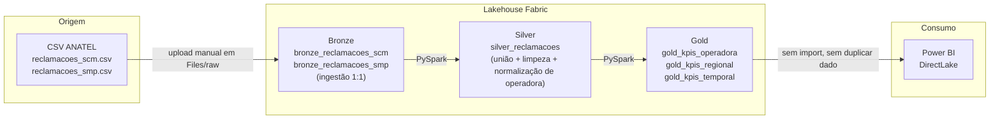

# Arquitetura — Fabric Lakehouse Demo

## Por que medallion e não uma tabela só

- **Bronze** existe para reprocessar a Silver sem depender do arquivo CSV original — e
  para auditar o dado exatamente como a fonte publicou, antes de qualquer regra de
  negócio ser aplicada.
- **Silver** aplica uma única vez a normalização de marca (mapear "Telefonica Brasil
  S.A." → `VIVO`) e a tipagem de data — a mesma regra usada em `src/kpis.py::_norm` do
  projeto principal, portada para PySpark, para as duas versões não divergirem por
  engano.
- **Gold** é o que o relatório consome: agregações prontas, sem lógica de negócio dentro
  do Power BI além do que já está pré-calculado.

## DirectLake vs. Import

O `.pbix` principal deste repositório usa modo **Import** — os dados são copiados para
dentro do arquivo. Aqui, o relatório lê o **Delta Lake diretamente** (DirectLake): não
duplica o dado, reflete a tabela Gold assim que ela é reescrita, e é o modo recomendado
pelo Fabric para relatórios sobre Lakehouse.
